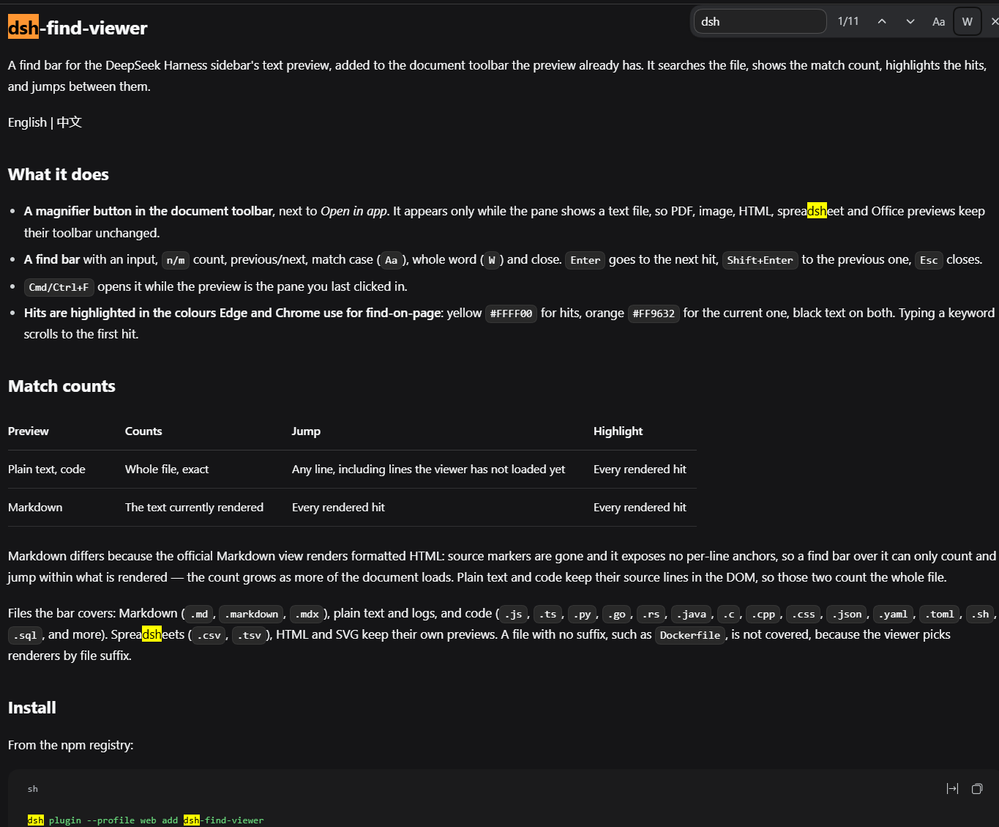
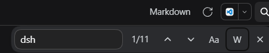

# dsh-find-viewer

A find bar for the DeepSeek Harness sidebar's text preview, added to the document
toolbar the preview already has. It searches the file, shows the match count, highlights
the hits, and jumps between them.

English | [中文](README.zh.md)





## What it does

- **A magnifier button in the document toolbar**, next to *Open in app*. It appears only
  while the pane shows a text file, so PDF, image, HTML, spreadsheet and Office previews
  keep their toolbar unchanged.
- **A find bar** with an input, `n/m` count, previous/next, match case (`Aa`), whole word
  (`W`) and close. `Enter` goes to the next hit, `Shift+Enter` to the previous one, `Esc`
  closes.
- **`Cmd/Ctrl+F`** opens it while the preview is the pane you last clicked in.
- **Search a selection**: select text in the preview, then open the bar — the selection
  becomes the keyword. A multi-line selection uses its first line; a selection longer than
  200 characters is ignored.
- **Hits are highlighted in the colours Edge and Chrome use for find-on-page**: yellow
  `#FFFF00` for hits, orange `#FF9632` for the current one, black text on both. Typing a
  keyword scrolls to the first hit.

## Match counts

| Preview | Counts | Jump | Highlight |
|---|---|---|---|
| Plain text, code | Whole file, exact | Any line, including lines the viewer has not loaded yet | Every rendered hit |
| Markdown | The text currently rendered | Every rendered hit | Every rendered hit |

Markdown differs because the official Markdown view renders formatted HTML: source
markers are gone and it exposes no per-line anchors, so a find bar over it can only count
and jump within what is rendered — the count grows as more of the document loads. Plain
text and code keep their source lines in the DOM, so those two count the whole file.

Files the bar covers: Markdown (`.md`, `.markdown`, `.mdx`), plain text and logs, and code
(`.js`, `.ts`, `.py`, `.go`, `.rs`, `.java`, `.c`, `.cpp`, `.css`, `.json`, `.yaml`,
`.toml`, `.sh`, `.sql`, and more). Spreadsheets (`.csv`, `.tsv`), HTML and SVG keep their
own previews. A file with no suffix, such as `Dockerfile`, is not covered, because the
viewer picks renderers by file suffix.

## Install

From the npm registry:

```sh
dsh plugin --profile web add dsh-find-viewer
```

Straight from GitHub:

```sh
dsh plugin --profile web add github:Makk9609/dsh-find-viewer
```

Then restart `dsh web`. Alternatively install it from the Plugin Market or the Plugin
Manager, which also enables the bundle for you.

Remove it with:

```sh
dsh plugin --profile web remove dsh-find-viewer
```

## How it works

The plugin has no build step and no runtime dependencies. Its browser half registers one
entry in the document toolbar's additive list slot
(`sidebar.right.tab.document.actions`), a slot that only appends, so no existing control is
replaced.

- Whole-file counting reads the file with the harness's own paged file Remote
  (`remote.workspaceFiles.read`), which is the same reader the preview itself uses.
- Highlights use the CSS Custom Highlight API: the bar registers ranges and never edits
  the DOM the official renderers own.
- Jumping to a line the viewer has not loaded yet asks the sidebar to navigate to that line
  (`sidebarRight.openResource`), which makes the viewer load the pages it needs.
- Locale lookups go through the client locale service (English and Chinese dictionaries are
  included).

It imports no harness client package as a module and registers no global keyboard handler;
`Cmd/Ctrl+F` is only intercepted while the preview is the pane you last clicked in.

## Limits

- The whole-file scan covers the first 20,000 lines or 4 MiB, whichever comes first; the
  find bar says so when a file is larger. Up to 3,000 hits are painted, and up to 50,000 are
  counted (`50000+` beyond that).
- Highlights need the CSS Custom Highlight API (Chromium 105+, Safari 17.2+, Firefox 140+).
  Where it is missing, counts and jumps still work and hits are not painted.
- Matches do not span lines.
- Verified against DeepSeek Harness `0.2.0-rc.2`. The plugin declares no `engines.dsh`
  range because its compatibility with later versions has not been tested.

## Development

```sh
npm test        # loads the browser half with stubs, then checks matching, address
                # decoding, the registration shape and the emitted highlight rules
```

`client.js` is the whole browser half and `index.js` is an empty host half, which exists so
the loader carries the package.

## License

MIT
